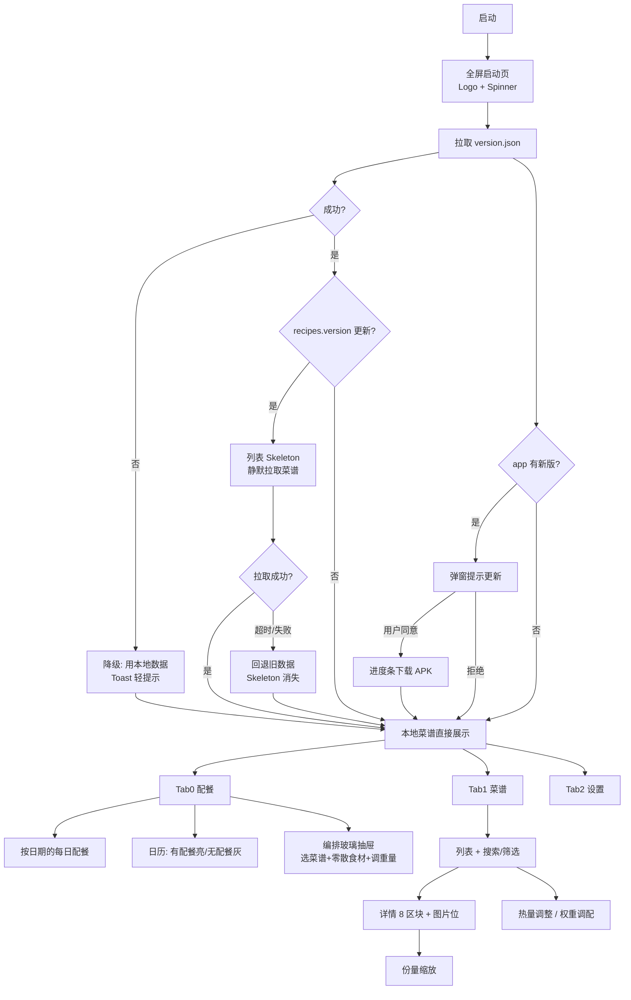
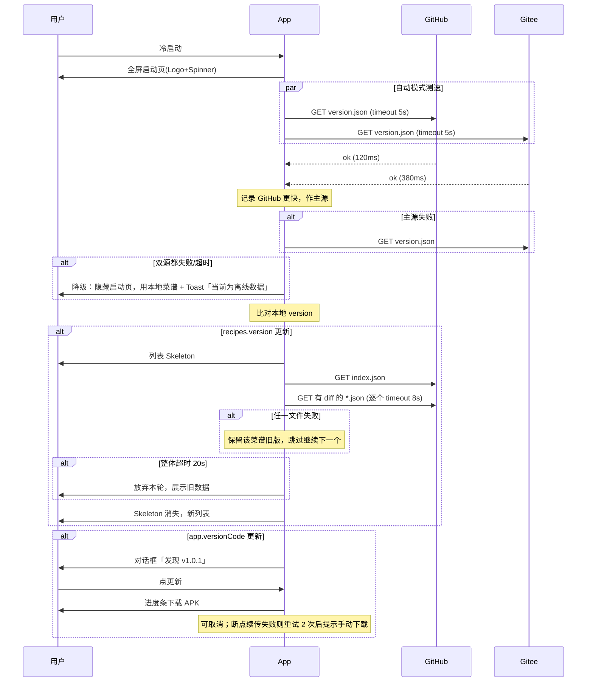

# 「于の食谱」完整方案 v2

> 状态：**待你审阅** · 尚未开始写业务代码
> 应用名：于の食谱 · 包名：`com.yunobase.recipe`（已确认）
> 品牌：于の小窝 / YUNO BASE · v2 增补：营养权重 / 份量缩放 / 图片预留 / 三态加载 / 全链路降级

---

## 1. 产品定位

一款安卓端营养餐谱阅读器。内置默认餐谱，可从 GitHub / Gitee 双源同步；支持份量缩放、热量目标动态调配（营养权重）。重点是把 JSON 营养数据在手机上舒服地呈现和微调，不做打卡/社交。

**一句话**：打开就能看今天这餐吃什么、多少热量，并能按健康权重把热量调到你想要的水平。

---

## 2. 技术选型

| 项 | 决定 |
|---|---|
| 平台 / 语言 | 原生 Android / Kotlin |
| UI | Jetpack Compose + Material 3（附带自定义 Spinner / Skeleton / Progress 组件） |
| minSdk / target | **29 可安装** · **31 为玻璃质感基线** · 35 target |
| 版本策略 | 以 API 31（Android 12）效果为设计/开发基线；29–30 安装可用并走降级（半透明+高光，无真模糊）；33+ 全量折射 |
| 架构 | 单模块 MVVM：Repository → ViewModel → Compose |
| 本地 | DataStore（设置+权重）+ filesDir（菜谱 JSON）+ assets（出厂默认） |
| 网络 | OkHttp + kotlinx.serialization |
| 拼音 | TinyPinyin |
| 视觉/动效 | **HyperOS 4 柔光玻璃** · 组件库 **Miuix**（miuix-ui/blur/squircle/nav/preference）+ 真实背景模糊降级，详见 `附录A-视觉与动效设计.md` |
| 构建 | Gradle + AGP 8.x + JDK 17 |
| 交付 | 完整 Android Studio 工程，你本地 `Build APK` |

---

## 3. 品牌视觉（HyperOS 4 · 小米蓝白系）

> UI 以小米 HyperOS 4 蓝白为主；活力橙退出界面主色，仅保留品牌 Logo 素材。  
> 明细见附录 A2.5。底部导航：图标在上 + 小文字在下。

| 角色 | 色值 | 用途 |
|---|---|---|
| 主色 · 澎湃蓝 | `#3482FF` | 主按钮、选中态、链接、进度 |
| 主色按下 | `#2B6FE0` | 按压 |
| 浅色背景 | `#F7F7F8` | 页面底 |
| 浅色表面 | `#FFFFFF` | 卡片/玻璃容器 |
| 深色背景 | `#000000` | 深色底 |
| 深色表面 | `#1C1C1E` | 深色卡片 |
| 次级文字 | `#8E8E93` | 辅助信息 |
| 分割线 | `#E5E5EA` / `#2C2C2E` | 弱分隔 |
| 成功/警告/超限 | `#34C759` / `#FF9F0A` / `#FF3B30` | 状态 |

深色模式：设置里「跟随系统 / 始终亮 / 始终暗」三态。Logo 用 YUNO BASE 素材，待你提供正式图标。

---

## 4. 信息架构



底部玻璃胶囊 **3 等分**：`配餐 | 菜谱 | 设置`，**图标在上 + 小文字在下**。  
「配餐」按**日期**组织早/午/晚；日历有配餐日亮色可点、无配餐日淡灰不可点；右下玻璃 FAB 进编排（玻璃抽屉）。

---

## 5. 数据模型

### 5.1 餐谱 JSON **v2**（现有 v1 自动迁移）

v1 字段全部保留，新增字段如下：

```jsonc
{
  "schemaVersion": 2,
  "id": "chao-qin-cai-pei-xun-ji",
  "name": "炒芹菜配熏鸡",
  "type": "dish",
  "serving": 1,
  "standard": "MIXED",

  // —— v2 新增 ——
  "dishType": "混搭",              // 肉菜|素菜|汤|主食|混搭|小吃|饮品
  "tags": ["家常", "高纤维"],
  "summary": "芹菜熏鸡配米饭，热量略超默认线",
  "image": null,                   // 预留: 相对路径或 URL，null 时占位图
  "ingredientGroups": [            // 预留: 食材分组（主料/辅料/调味）
    { "title": "主料", "items": ["芹菜", "熏鸡", "熟米饭"] }
  ],

  "totals": { "weight": 522.5, "energy": 444.9, "carb": 44.9, "protein": 20.4,
              "fat": 20.7, "vitaminC": 41.9, "fiber": 5.5, "sodium": 1283.9 },
  "targets": { "energyMax": 420, "energyBest": 400, "weightMax": 550,
               "weightBest": 500, "energyOk": false, "weightOk": true,
               "doseStatus": "OUT_OF_RANGE" },
  "macroRatio": { "carbPct": 40.1, "proteinPct": 18.2, "fatPct": 41.6 },

  "items": [
    {
      "name": "芹菜", "weight": 190,
      "energy": 26.6, "carb": 5.7, "protein": 1.3, "fat": 0.4,
      "vitaminC": 5.9, "fiber": 3.0, "sodium": 152.0,
      "category": "蔬菜",            // v2: 归类
      "healthWeight": 0.92,          // v2: 营养权重 0.01~1.00，技能写入，用户不可改
      "locked": false,               // v2: true 时调配时不缩放（如精盐）
      "source": "USDA Celery, raw (fdcId 169988)",
      "per100": { "energy": 14, "carb": 3.0, "protein": 0.7, "fat": 0.2,
                   "vitaminC": 3.1, "fiber": 1.6, "sodium": 80 }
    }
  ],

  "notes": ["..."],
  "sources": [{ "name": "...", "url": "..." }],
  "generatedAt": "2026-10-05T21:32:00",
  "generatedBy": "Xiaomi MIMO 2.6 Pro",
  "user": "Yu_xiaohei"
}
```

`items[].category` 取值：`蔬菜 | 菌藻 | 主食 | 肉蛋 | 水产 | 豆奶 | 油脂 | 调味 | 其他`。
缺省时由 `items[].source` + 名称规则自动推断。

### 5.2 菜谱索引 `recipes/index.json`

```jsonc
{
  "schemaVersion": 2,
  "version": "2026.10.05.1",
  "updatedAt": "2026-10-05T21:32:00",
  "recipes": [
    {
      "id": "chao-qin-cai-pei-xun-ji",
      "file": "chao-qin-cai-pei-xun-ji.json",
      "name": "炒芹菜配熏鸡",
      "dishType": "混搭",
      "tags": ["家常"],
      "summary": "……",
      "image": null,
      "energy": 444.9,
      "weight": 522.5,
      "serving": 1,
      "generatedAt": "2026-10-05T21:32:00"
    }
  ]
}
```

### 5.3 云端总版本 `version.json`

```jsonc
{
  "schemaVersion": 1,
  "app": {
    "versionName": "1.0.0",
    "versionCode": 1,
    "minSupported": "1.0.0",
    "apkUrl": "https://.../app/yurecipe-v1.0.0.apk",
    "changelogUrl": "https://.../CHANGELOG.md",
    "notes": "首个版本"
  },
  "recipes": {
    "version": "2026.10.05.1",
    "indexUrl": "https://.../recipes/index.json"
  }
}
```

### 5.4 营养权重（**跟餐谱走，用户不可改**）

权重写在**每道菜谱的 JSON 里**，由 `recipe-nutrition` 技能在生成时写入，App 只读不算改。

**每个食材一项 `healthWeight`**：

```jsonc
{
  "name": "芹菜",
  "weight": 190,
  "healthWeight": 0.92,     // 0.01（最低）~ 1.00（最高）
  "category": "蔬菜",
  /* 其余营养字段 */
}
```

取值语义（**越高越健康、越保护**）：

| 区间 | 含义 | 调热量时 |
|---|---|---|
| 0.80–1.00 | 优质主体（蔬菜/菌藻/优质蛋白） | 加量多给、减量少砍 |
| 0.50–0.79 | 常规（主食/水产/豆奶） | 中性缩放 |
| 0.20–0.49 | 需控制（肥肉/油脂/主食过量部分） | 加量少给、减量多砍 |
| 0.01–0.19 | 尽量压缩（精盐/酱油/糖/调味） | 减量优先砍；也可由技能标 `locked: true` 锁克数 |

建议默认（技能可按菜式微调）：

```
蔬菜 0.85–0.95 · 菌藻 0.85 · 豆奶 0.75 · 水产/瘦肉 0.70 ·
主食 0.55–0.65 · 肥肉 0.35 · 烹调油 0.30 · 调味 0.05–0.15 · 精盐 0.01
```

**用户唯一能操作的**：在 App 里设「目标总热量」或「目标总重量」，系统按 `healthWeight` 自动调配全部食材克数。用户改不了权重本身。

---

## 6. 云端仓库约定

### 6.1 目录结构（GitHub / Gitee 同构镜像）

```
repo-root/
├── version.json
├── CHANGELOG.md
├── app/
│   └── yurecipe-v1.0.0.apk
├── recipes/
│   ├── index.json
│   ├── *.json
└── images/                    # 菜谱图（预留）
    └── chao-qin-cai-pei-xun-ji.jpg
```

### 6.2 你这边只需做三件事

1. **建两个公开仓库**（GitHub + Gitee，名字随意，例如 `yuno-recipe-data`），结构按 6.1。
2. **决定内容谁上传**：
   - 选 A（推荐）：把 **personal access token**（repo 写权限）给我或配到本机，我用脚本初始化 `version.json` / `recipes/` / 首版 APK。
   - 选 B：你自己拖文件上传，我只产出模板和校验脚本。
3. **把两个仓库的 URL 发我**（形如 `https://github.com/<you>/yuno-recipe-data`）。

**注意**：仓库必须**公开**。App 内不放任何 token，客户端只读 raw/公开 API。私有仓库等于要把密钥打进 APK，不安全，不建议。

App 读取地址写法（`version.json` 里的 `indexUrl` / `apkUrl` / `changelogUrl` 用 raw 地址）：

| 平台 | raw 模板 |
|---|---|
| GitHub | `https://raw.githubusercontent.com/<user>/<repo>/<branch>/<path>` |
| Gitee | `https://gitee.com/<user>/<repo>/raw/<branch>/<path>` |

---

## 7. 更新机制 + 降级冗余

### 7.1 拉取策略

| 设置 | 行为 |
|---|---|
| 自动（默认） | 同时对双源发轻量探测（`version.json` HEAD/GET），比延迟，择优；结果缓存 24h；失败即切另一源 |
| 仅 GitHub | 只用 GitHub；连续失败 2 次提示「是否临时改用 Gitee」 |
| 仅 Gitee | 只用 Gitee；连续失败 2 次提示「是否临时改用 GitHub」 |

### 7.2 启动时序（含降级）



### 7.3 降级矩阵（每一环都有退路）

| 故障 | 降级行为 |
|---|---|
| 双源 version.json 均超时 | 用本地数据，Toast 提示离线 |
| 主源失败 | 自动切备用源 |
| index.json 失败 | 不动本地列表，只提示「同步失败」 |
| 单个菜谱 JSON 失败 | 跳过该条，其余照常更新 |
| JSON 解析失败 | 丢弃该文件，保留旧版本 |
| 下载中断（菜谱） | 本轮未完成的保持旧文件 |
| APK 下载失败 | 重试 2 次 → 提示「复制下载链接手动安装」 |
| 本地文件损坏 | 从 assets 出厂默认恢复 |
| 存储写失败 | 只更新内存态，提示「本地保存失败」 |
| 拼音库异常 | 搜索回退为纯汉字子序列匹配 |

超时约定：version 5s · index 8s · 单菜谱 8s · 整批 20s · APK 进度条无硬超时但 15min 取消。

---

## 8. 营养权重与目标调配

### 8.1 概念

- 权重 `healthWeight`（0.01–1.00）**随餐谱 JSON 分发**，生成时由 `recipe-nutrition` 技能写入，App 只读。
- 权重 = 「变总量时，这个食材该多动还是少动」——健康值高的食材加热量时多给、减热量时少砍；调味/油等低权重食材相反。
- **用户只设目标**：目标总热量 **或** 目标总重量（二选一为主目标），系统自动调配。

### 8.2 调配算法（按目标）

设当前总热量 `E0`、总重 `W0`，食材 `i` 的克数 `g_i`、权重 `w_i ∈ [0.01, 1.00]`、当前热量 `e_i`。

**A. 目标热量 `E_target`（先算比例 `k = E_target / E0`）**

1. `k = 1` 不处理。
2. **加热量**（`k > 1`）：增量按权重分配  
   `scale_i = 1 + (k - 1) × (w_i / mean_w)`
3. **减热量**（`k < 1`）：减量按「反权重」分配（保护高权重）  
   `cut_i = (1.01 - w_i) / mean(1.01 - w)`  
   `scale_i = 1 - (1 - k) × cut_i`
4. `new_g_i = max(g_i × scale_i, min_g_i)`  
   `min_g_i`：调味 0.1g、油脂 0.5g、其它 1g；标了 `locked: true` 的不缩放。
5. 按 `per100` 重算全部营养、`totals`、`macroRatio`、`targets` 状态。
6. `notes` 追加一条：「按目标热量 X kcal 按 healthWeight 调配」。

**B. 目标总重 `W_target`**

- 先按 `scale = W_target / W0` 均匀试算，再用 A 的权重规则微调能量分布（可选「保持供能比」开关）。
- 默认简单模式：全部 `g_i × (W_target/W0)` 线性缩放，权重只用于微调 ±15% 差异。

**C. 同时给热量+重量目标**  
以热量为准，重量只作校验提示（超重/欠重时 Snackbar 提醒）。

结果只存**本地草稿**，可「撤销 / 另存为新菜谱」，不覆盖云端原始 JSON。

---

## 9. 份量缩放

- 详情页顶栏有 `×0.5 ×1 ×2` 快捷按钮 + 自定义人数。
- 所有食材重量与营养按比例线性缩放；`serving` 字段同步。
- 与 §8 调整可叠加：先缩放再调热量（或反之），历史步骤可回退。
- 缩放结果同样只存本地草稿。

---

## 10. 搜索与筛选（不变，简记）

- **≥3 字符**才触发过滤。
- 命中：汉字**子序列** / 全拼包含 / 拼音首字母包含。
- 列表：分类 chips · 标签 · 热量区间 · 排序（名称 / 最近 / 热量）。

---

## 11. 界面规格（HyperOS 4 柔光玻璃 + 全套动效）

> 视觉语言：**小米 HyperOS 4**——悬浮玻璃胶囊导航、真实背景模糊、触点光、空间连续弹性动效。
> 动画清单见 **`附录A-视觉与动效设计.md`**（A3 含底栏 N1–N7 主秀场）。
> 下面只列区块结构；材质、参数、曲线以附录 A 为准。

### 11.1 启动页（版本获取中）

```
┌────────────────────────────┐
│                            │
│         [ LOGO ]           │  ← 品牌图标，居中偏上
│                            │
│        于の食谱             │
│                            │
│         ◌ ◌ ◌              │  ← Spinner（活力橙圆弧转圈）
│                            │
│     正在同步餐谱数据…        │  ← 300ms 后才出现，防闪
│                            │
└────────────────────────────┘
```

- 全屏，品牌纸白/暗夜黑随主题。
- 成功或降级后淡出 200ms 进主页。
- 可配置最长展示 20s（正常远短于此）。

### 11.2 列表 Skeleton（拉新菜谱时）

```
┌────────────────────────────┐
│ 于の食谱            [刷新]  │
│ [🔍________________]        │
│ [全部][肉菜][素菜][汤]      │
│ ┌────────────────────────┐ │
│ │ ████████████████  ▓▓▓▓ │ │  ← 灰色渐变骨架
│ │ ████████  ▓▓▓▓  ▓▓▓▓   │ │
│ └────────────────────────┘ │
│ ┌────────────────────────┐ │
│ │ ████████████████  ▓▓▓▓ │ │
│ │ ████████  ▓▓▓▓  ▓▓▓▓   │ │
│ └────────────────────────┘ │
└────────────────────────────┘
```

- 拉新时**整表替换**为骨架（保持列表高度，不跳动）。
- 骨架块数量 = 旧列表条数（或最少 4 个）。
- 完成后交叉淡入真实数据。

### 11.3 详情页（8 区块 + 图片位 + 操作条）

| # | 区块 | 说明 |
|---|---|---|
| 0 | **图片位（预留）** | 顶部 16:9；无图显示品牌色渐变 + 菜名 |
| 1 | 头部 | 菜名、生成时间、份量、生成工具 |
| 2 | 总览三卡 | 热量 / 重量 / 食材数（橙色强调） |
| 3 | 目标对照 | 进度条 vs 最佳/上限，超限标红 |
| 4 | 供能比 | 三段比例条 |
| 5 | 食材明细 | 可展开 8 项 + per100 + source |
| 6 | 数据说明 | 折叠 `notes[]` |
| 7 | 数据来源 | 外链列表 |
| 8 | 生成信息+版权 | 小灰字 |

**底部操作条**（预留拓展）：`调整热量` · `份量缩放` · `刷新`

Section 容器为槽位式，后期加「做法步骤」「图片集」只需注册新 Section。

### 11.4 调配抽屉（目标热量/重量）

- 玻璃抽屉（T7），背景压暗模糊
- 用户只设两样：**目标总热量** 或 **目标总重量**（大数字 + 快捷 ±%）
- 食材列表实时预览缩放（按 `healthWeight`，M12）；权重值只读展示
- 「预览 / 另存 / 取消」玻璃按钮三件套

### 11.5 APK 更新进度条

```
┌────────────────────────────┐
│  正在下载 v1.0.1            │
│  ████████░░░░░░  42%        │
│  3.2 MB / 7.6 MB            │
│        [取消]               │
└────────────────────────────┘
```

活力橙进度条 + 百分比 + 已下/总大小，可取消。

### 11.6 设置页

```
深色模式          [跟随系统 ▾]     ← Liquid 玻璃 Toggle
拉取方式          [自动 ▾]
当前版本           v1.0.0
检查更新           [点]            ← 玻璃按钮
更新日志           [点]
─────────────────
© 2024-2026 YUNO BASE
基于 CC BY-NC-ND 4.0
未经作者允许禁止商业二次转载
```

（备案号你说了先不加，结构上预留了一行空位。权重不在设置里改——写死在餐谱 JSON 里。）

**底部 Tab 栏是全 App 最需要柔光玻璃的地方**：悬浮玻璃胶囊（56dp）+ 液态选中镜片（48dp）浮在 edge-to-edge 内容之上；**图标在上、小文字在下**，3 等分（配餐/菜谱/设置）；镜片可拖动、按压出触点光（附录 A3.2 N1–N7）。主色用澎湃蓝 `#3482FF`。第一优先级做精。

---

## 12. 加载与降级总原则

1. **永不白屏**：任何网络等待要么有启动页，要么有 Skeleton，要么直接展示旧数据。
2. **静默更新菜谱**：不打断阅读；失败不弹大窗，只用 Snackbar。
3. **客户端更新必须用户确认**。
4. **本地永远可用**：assets 出厂菜谱是最后兜底。
5. **逐项成功原则**：批量拉取时部分失败不影响其它项。
6. **可取消**：APK 下载、手动刷新都可中途取消。
7. **动效可降级**（见附录 A5）：API 29–32 无 AGSL 自动降级；「减弱动画」模式替换全部装饰动效；省电时暂停循环动画；玻璃渲染异常回退半透明渐变。

---

## 13. 工程结构

```
F:\Yuno-Develop\餐谱\YUNO-recipe\
├── docs/
│   ├── 于の食谱-完整方案.md          ← 本文件
│   └── 附录A-视觉与动效设计.md        ← 玻璃材质 + 全套动画清单
├── json/                             ← 原始餐谱 JSON（v1）
├── cache/                            ← 历史测试缓存
├── *.md                              ← Markdown 餐谱
├── scripts/
│   └── migrate_v1_to_v2.py           ← 菜谱 v1→v2 升级脚本
└── android/
    ├── settings.gradle.kts
    ├── build.gradle.kts
    ├── gradle.properties
    └── app/src/main/
        ├── AndroidManifest.xml
        ├── assets/recipes/           ← 出厂默认（v2 JSON）
        ├── java/com/yunobase/recipe/
        │   ├── MainActivity.kt
        │   ├── YuRecipeApp.kt
        │   ├── data/
        │   │   ├── model/            # Recipe v2, Item, WeightConfig…
        │   │   ├── local/            # RecipeStore, SettingsStore, DraftStore
        │   │   └── remote/           # UpdateService, SourceClient, Downloader
        │   ├── domain/
        │   │   ├── SearchMatcher.kt
        │   │   ├── RecipeClassifier.kt
        │   │   ├── WeightAdjuster.kt    # §8 调热量
        │   │   ├── ServingScaler.kt     # §9 份量缩放
        │   │   └── Migrator.kt          # v1→v2
        │   └── ui/
        │       ├── theme/               # Miuix 主题 + 品牌橙 + 动效 token
        │       ├── glass/               # 柔光玻璃封装 / 悬浮胶囊导航
        │       ├── components/          # Spinner, Skeleton, ProgressBar, 数字滚动
        │       ├── nav/                 # SharedTransitionLayout + 导航
        │       ├── list/
        │       ├── detail/
        │       ├── adjust/              # 目标热量/重量调配玻璃抽屉
        │       └── settings/            # 设置（权重不在这里改）
        └── res/values/
```

---

## 14. 里程碑

| 阶段 | 产出 | 你能看到 |
|---|---|---|
| **M0 菜谱升级** | `migrate_v1_to_v2.py`，把 `json/` 全部升到 v2，出校验报告 | 升级前后的 JSON diff |
| **M1 骨架** | 工程可编译、两 Tab、品牌主题、**YuGlass 玻璃组件**、启动页液态 Spinner | AS 可运行的壳 + 玻璃 Tab 栏 + 启动动画 |
| **M2 数据渲染** | v2 解析、列表、详情 8 区块+图片位、份量缩放、**详情过场（共享元素）** | 真实餐谱可浏览 |
| **M3 本地体验** | 搜索/筛选/排序/折叠、权重调热量、**组件微动效全开** | 交互完整 |
| **M4 更新** | version 协议、双源、延迟优选、Skeleton shimmer、降级矩阵、APK 进度条液态填充 | 真同步 |
| **M5 设置与收尾** | 设置 5 项、权重子页、更新日志 WebView、图标、**减弱动画模式**、降级自测清单 | 可发布 |

**M0 会在写 App 之前先做**（你要求的：开工前先升级现有菜谱）。

---

## 15. 云端侧：你只需…

1. 建 **两个公开仓库**（GitHub + Gitee），命名随意。
2. 给我仓库 URL；若希望我初始化内容，再给 **repo 写权限 token**（或你自行上传）。
3. 其余（`version.json` / `index.json` / 目录 / 上传脚本）我来产出。

---

## 16. 已确认 / 待定

| 项 | 状态 |
|---|---|
| 包名 `com.yunobase.recipe` | ✅ |
| 备案号 | ✅ 先不加（页脚留空位） |
| 菜谱图片 | ✅ 排版预留，后补图 |
| 份量缩放 | ✅ 做 |
| **营养权重 healthWeight 0.01–1.00** | ✅ 跟餐谱 JSON，技能写入，用户不可改；用户只设目标热量/重量 |
| 菜谱 v1→v2 先升级 | ✅ M0（含补写 healthWeight） |
| 三态加载动画 | ✅ §11.1–11.5 |
| 全链路降级冗余 | ✅ §7.3 |
| **HyperOS 4 柔光玻璃 UI** | ✅ 附录 A · 悬浮玻璃胶囊导航 · Miuix |
| **全套动效（过场/微动效/加载/手势）** | ✅ 附录 A3 |
| **配色：小米蓝白 `#3482FF`** | ✅ 活力橙退出界面主色 |
| **第三 Tab「配餐」** | ✅ 图标上/文字下 · 按日期 · 日历亮暗 · FAB · 编排玻璃抽屉 |
| **Miuix 落地可行性** | ✅ 附录 A5.1（对照 NexioSchedule；29–30 降级） |
| UI 精修稿（Figma） | ⏳ 待你设计后对齐落地 |
| `recipe-nutrition` skill 加权重输出 | ⏳ 待你改 skill（见 `skill改造说明.md`） |
| 仓库 URL / token | ⏳ 待你 |
| 正式 App 图标 | ⏳ 待你 |
| 收藏 / 餐次浏览 | ⏳ 可选，第一版先不做 |

方案到此。有要改的直接说；确认后按 **M0 → M5** 开工。
