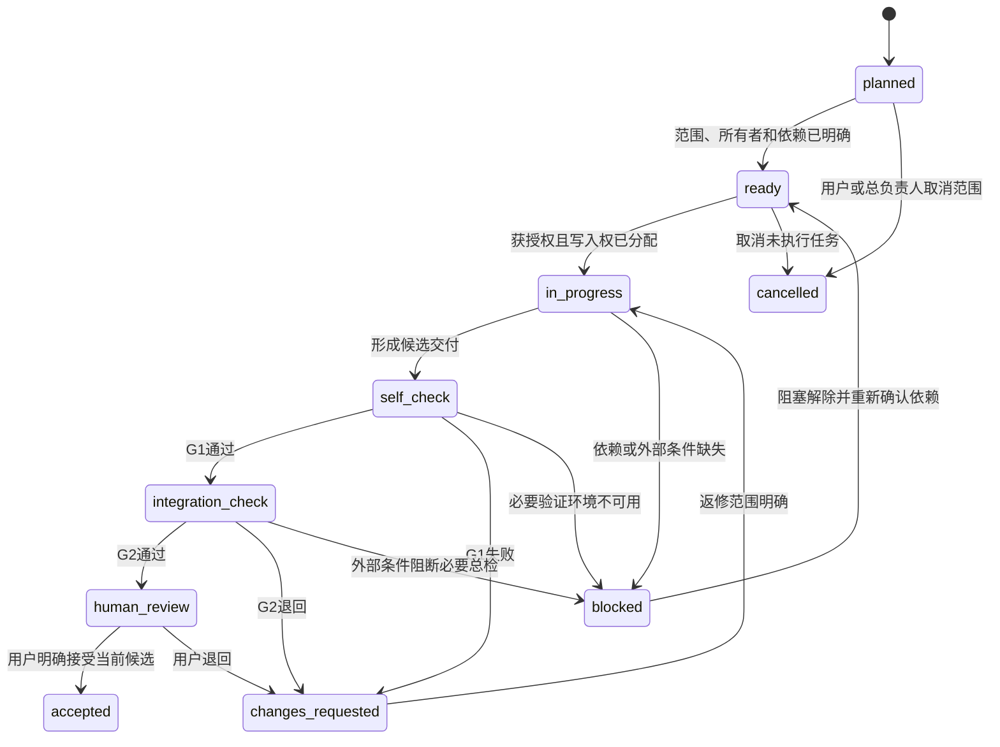

# 质量、复核与多 Agent 协作方案

> 2026-10-28。作者自检与总负责人总检已完成，等待用户按批次人工复核。本文定义后续工作的准入条件，不表示任何 Android 构建、运行、同步或发布检查已经通过。适用于 P0～P3；任务编号与粒度由总负责人维护。

> 2026-10-29状态补充：上述为B00编写时的状态；用户现已接受B00并授权P0。B01契约候选按本方案三检，评审入口见[本批说明](../reviews/B01/README.md)，B02及后续仍等待B01人工接受。

## 1. 本项目的质量责任

总负责人承担需求解释、共享契约、任务拆分、并行调度、集成核对和交付真实性；子 Agent 对获派范围内的实现与自检负责。用户保留新用户可见名称、产品不确定项、人工体验与最终接受的决定权。

本轮只制作规划及 UX 交接资料，不初始化 Android 工程、不安装 SDK、不写云端、不推送仓库、不发布 APK。后续执行具体任务前检查其授权范围。

质量链固定为 **执行者自检 → 总负责人总检 → 用户人工复核**。总负责人可以邀请其他 Agent 提供独立检查，但必须亲自核对证据、处置问题并给出集成结论。子 Agent 声称“完成”只表示已提交待审交付，不能代替总检或用户接受。

## 2. 编辑批次与三道关卡

### 2.1 审查批次

编辑批次是一项能够独立解释、独立验证和必要时回退的小交付，通常对应一个任务或一组共享同一验收场景的任务。批次在开始前确定范围、文件所有权、依赖和验收方式；不能在结束后临时扩大批次来隐藏未验收内容。

每次形成候选交付或修订候选交付都要自检。可以在一个候选批次中连续编辑相关文件，再一次提交完整 diff 与检查结果，不要求每次保存文件都打断用户。并行任务可组装成有限、清楚的人工复核批次；待用户回答时，只继续与该批依赖无关的工作。

| 关卡 | 责任人 | 必要动作 | 通过证据 | 未通过时 |
|---|---|---|---|---|
| G1 自检 | 当前编辑者 | 对照任务与契约逐项检查；验证修改文件及受影响路径；列出差异和限制 | 文件清单及 hash/提交标识、命令/案例与结果、未运行项、已知问题 | 修复后重检，不交给用户承担第一轮排错 |
| G2 总检 | 总负责人 | 检查 G1 证据；核对跨文件、跨模块、需求、UX/UI、数据与版本一致性；运行必要集成验证 | 总检结论、发现及处置、与候选版本匹配的集成证据 | 退回具体任务；隔离受影响批次，不继续叠加其下游改动 |
| G3 人工复核 | 用户 | 查看精简变更说明、图稿/可运行交付和复核步骤；确认名称、行为及范围 | 用户在聊天中的明确通过/退回，记录对应批次和候选版本 | 保持 human_review 或进入 changes_requested；无回复不等于通过 |

文档批次的 G1 检查链接、ID、JSON、图稿和跨文档规则；G2 检查覆盖度与并行边界；G3 提供入口和少量明确检查点。实现批次的 G1/G2 根据风险运行测试和实际流程；G3 提供可安装包或明确演示方式。用户不需要阅读全部代码，也不替代自动化检查。

代码通过用户人工复核只表示接受该候选批次，不意味着授权公开发布、向外发送消息或删除远端数据。

### 2.2 每批次提交包

1. 一句话说明交付行为及范围，列出任务 ID 和前置批次。
2. 候选标识：Git commit/分支可用时记录其值；尚无 Git 时记录相对文件清单和 SHA-256。证据不得只写“最新版”。
3. 修改清单：新增/修改/删除、共享契约变更及与上一版的差异。
4. G1/G2 证据：实际执行的命令、环境/API、关键案例、退出结果及报告路径；未执行的明确写 not_run 和原因。
5. 问题清单：严重性、影响、处理结论；需要用户选择的内容在聊天中一次问一项。
6. 人工复核入口和最多一个主题的复核请求，附可复现操作或代表页面。记录结论后再推进依赖该批的下游任务。

### 2.3 返修和证据失效

人工复核或总检退回后，由原任务负责人返修。每次改变候选内容，G1 必须重新执行，受影响的 G2/G3 签核失效；证据注明新的候选标识。总负责人进行影响分析，重跑受影响测试与回归，不需要无条件重跑全部无关检查。

发现已接受批次存在缺陷时，创建关联修复任务，标记受影响的下游批次。涉及数据丢失、历史重算、契约错误、低版本崩溃或凭据风险的批次停止集成；修复通过三检后恢复。不能修改测试预期、屏蔽错误或删除失败断言来获得通过。

## 3. 状态机与进度口径

状态是内部调度名称，不作为新用户可见功能名称。建议任务记录使用以下主状态，检查结论另记 `pass/fail/not_run`，避免把环境缺失误写成已检失败。



| 状态 | 进入条件 | 禁止表达 |
|---|---|---|
| planned | 范围仍在拆分或等待前置条件 | 不写“已开始实现” |
| ready | 依赖候选已接受、验收可执行、写入所有权明确；无未决产品选择 | 不写“已通过” |
| in_progress | 获得执行权，正在制作交付 | 不按耗时推算完成率 |
| self_check | 当前候选的执行者检查中 | 子 Agent 不能直接将其改为 accepted |
| integration_check | G1 通过，总负责人正在核对 | 不把局部通过当作全流程通过 |
| human_review | G1/G2 通过，等待用户当前候选的明确复核 | 不以超时、沉默或下一条无关消息代替接受 |
| accepted | 用户明确接受，三检证据指向同一候选 | 不等于已部署或已发布 |
| changes_requested | 检查失败或收到退回意见 | 不新增依赖该候选的下游功能 |
| blocked | 缺少必要信息、环境、权限或外部服务；写明恢复条件 | 不写 fail，也不把它从验收中删除 |
| cancelled | 任务明确取消，记录原因与遗留产物 | 不通过删除记录掩盖未完成工作 |

执行中需要取消任务时先交接现有产物与安全状态，再转为 cancelled，不丢弃工作。`blocked` 记录原状态、原因、受影响任务、可独立推进的部分及下一项具体动作；条件解除后回到 ready 重新检查，保留历史检查结果。

进度按 accepted 的任务/验收条目统计，并明确分母；规划文档的 accepted 不计为 App 功能开发完成。当前 App 实现仍为 0%，本轮产物属于规划与设计。

## 4. 多 Agent 写入与并行准则

### 4.1 调度容量与责任

当前会话最多 4 个并发槽：总负责人 1 个，执行/检查子 Agent 合计最多 3 个。角色是职责而非永久分组，不能计划成 4 个子 Agent 加 1 个总负责人同时运行。总负责人优先保留集成与用户沟通能力，不为了填满槽位而制造依赖。

本轮可同时进行：UX 子 Agent 写 `docs/ux/`；质量子 Agent 写本文件；总负责人细化任务与项目规则。文件不得交叉写入。独立审查使用空闲槽，或在某执行者交付后复用其槽位；审查者只读他人产物，将建议交给所有者或总负责人处理。

### 4.2 可并行与必须串行

| 工作组合 | 并行条件 | 串行边界 |
|---|---|---|
| P0 工具链/材质验证、数据契约/算法、UX 图稿 | 文件范围独立；共同只读已确认规则 | 共享契约及视觉运行结论由总负责人统一核对后才能成为实现基线 |
| P1 食谱浏览/搜索、配餐编辑/持久化、主题/状态组件 | 模型、Repository 接口、路由/状态输入已冻结；公共壳由单一所有者维护 | 同一个导航入口、数据库迁移、公共组件母版不允许多人同写 |
| P2 目标编辑、JSON 往返、公共源、私人同步 | 按最多 3 名子 Agent 分波运行；共享身份、revision/hash 和事务规则已接受 | 导入与同步同时改同一 repository/事务时需分离接口并由总负责人集成 |
| P3 发布资产、许可/隐私清单、回归执行 | 发布候选及数据流稳定，报告互不覆盖 | 签名、versionCode、发布包和远端发布由单一所有者顺序处理；公开发布需用户明确授权 |
| 任一任务 + 另一 Agent 的独立审阅 | 审阅绑定固定候选，执行者暂停该候选写入 | 内容有变更即重新标识；不能边改边引用旧证据批准 |

下游可以在未接受前置产物时进行只读调研或明确隔离的探索，但不能将探索代码集成、把共享契约当已冻结，或宣称已经越过依赖门槛。任何需要用户裁定的新产品行为均暂停相关实现，其他独立工作继续。

### 4.3 单文件所有权

每项任务交接必须列 `writeScope`、`readScope`、`forbiddenScope` 和所有者。一个文件在同一时间只有一名写入所有者。请求修改他人范围时发送变更建议，由总负责人转交或重新分配；不得先改后通知。

共享文件如根 `AGENTS.md`、构建版本目录、应用入口、数据库版本/迁移注册、导航注册、发布配置、共用 JSON schema、任务台账和总日志由总负责人或其明确指定的一名整合者维护。子 Agent 在报告中给出拟修改内容，避免同时追加造成覆盖。不要默认 `git add .` 混入其他 Agent 的文件。

当前多人共享同一目录时，以实际写入范围为隔离手段。后续用户授权任务涉及代码并行，可由总负责人按工程情况选择分支/工作树；创建隔离目录并不自动复制未提交变更，必须检查起点和交接。不能用复制整个工作区来回覆盖代替集成。

### 4.4 共享契约冻结与变更

冻结对象至少包括：Recipe/Ingredient/混合库索引/GoalProfile/MealRecord/schema 版本及缺失值口径、日期与餐次的唯一性、quantity/group identity/count/原始份量与微调总量的独立含义、Repository 方法和事务边界、调配输入输出/精度/算法版本、滑块 anchor 与范围、路由参数与 screen ID、UI 状态及动作、revision/hash/ETag/tombstone 同步含义。混合库必须有明确类型判别，不能凭是否存在某个可空字段猜测类型。冻结意味着三检通过的明确候选，并非永不修改。

变更流程：提出原因与影响 → 总负责人识别调用方/数据迁移/测试/UX 影响 → 必要产品决策由用户确认 → 生成新契约候选及差异 → 自检/总检/人工复核 → 单一所有者更新基线 → 通知所有受影响 Agent 重新对齐。内部重命名也需同步引用；不得私自修改 schema 或枚举让自己的模块通过。

## 5. 项目关键不变量与验证矩阵

风险分类仅是内部审查级别。新增或修改时由总负责人判定影响范围；存在核心风险时采用更严格等级。下列是待执行验收要求，当前没有测试通过结论。

| 风险级别/领域 | 必须保持的不变量 | G1 主要证据 | G2 主要证据 | G3 可复核内容 |
|---|---|---|---|---|
| 核心：重量与能量调配 | healthWeight 有界重分配；locked 克数不变；未知能量不参与假定求解；从原快照重算 | 可达/不可达、全锁定、边界、零/缺失能量、舍入、增减方向、反复调整测试；原文件无修改 | 独立复算样例；目标残差、量化后边界和实际合计；算法版本与 UI 状态一致 | 调整前后食材预览；不可达明确显示实际结果；重置和取消 |
| 核心：独立食材与混合库 | 独立食材来自用户新建的每 100g 详细 JSON；与食谱同库但类型明确；公共 Recipe 来源从 100g 起步；单食材调量线性换算，不调用 recipe healthWeight 重分配 | Recipe/Ingredient 类型分发、来源 100g 基准与 Ingredient 每100g单位、foodState、null 与 0、缺失/非法类型、线性调量与往返样例 | schema、索引、详情、加入配餐和历史快照保持同一类型/单位；不得把来源 100g 当成 UI 最低重量或自动从旧食谱提取生熟未知条目，不新增 App 手工营养录入 | 从“食材”标签选择、查看信息及加入配餐；调整重量后营养按量变化，未知值仍为未知 |
| 核心：数量分组与总量微调 | 每日期+餐次一份；重复加入同一库记录合并显示 xN；不同记录即使hash相同也分开；展示总重量营养；微调只改总量；删除扣原始份量；0≤重量<1g 红框无效、可滑块修正且保存阻止，所有条目至少 1g 才满足重量有效条件；异常负值强制 0g | quantity/group identity/count/原始份量、[0,1)g无效与1/9/10g有效、混合有效无效条目、锁定、重开与同步竞争；600g+100g=700g，删除原始 300g 后为 400g x1；反复操作不得扩大固定范围 | 组身份、当前总量、原始叠加量与 anchor 持久化一致；删除结果保留，范围按原始单份×当前份数计算，不以当前量重锚或静默 clamp；唯一键与事务竞争检查 | xN 与总量含义清楚；拖动不再乘 N；重开不重置微调；红框可修正，保存不能绕过无效条目 |
| 核心：目标判断 | target/range/max 三模式、无目标中性、max=0 不除零；示例数字不是默认建议 | 边界内/10%/20%/刚越界、null/0/非法区间、比例和手动覆盖测试 | 编辑与详情使用同一规则版本；日/餐差额与历史快照一致 | 钠低于上限不显示缺少，目标类型及手动覆盖提示可理解 |
| 核心：快照/本地保存 | 配餐保存原料、调整值、目标、餐次及算法版本；目标和餐次变更不重算历史；公共Recipe/Ingredient自动更新重算；D13保留实际总重已确认，D14上下限自动调整已确认 | 保存/重启/杀进程、事务失败回滚、模板改名/停用、锁定解锁、日期测试 | 更新或移除公共食谱后的历史可读性；草稿返回和数据库迁移检查 | 断网浏览→加入→保存→重启；锁定后主动解锁 |
| 核心：JSON 导入导出 | 预览前不写库，取消无写入，事务原子性，高版本明确拒绝，无效记录列出原因后只提交有效记录；凭据排除 | 有效往返、重复库身份冲突、同名异hash与同hash独立记录、损坏、超限、取消、写入中断、未知版本、部分无效导入（ 10 条中 2 条错误只导入 8 条） | 与正式 schema/数据库/历史快照一致；导出不含密钥；系统文件访问流程 | 预览数量/日期/冲突/错误原因、取消后原数据不变；恢复结果清晰
| 核心：123 WebDAV | 先本地后同步；条件写入保护；双端修改保留两份；配餐清除按选项2同步删除远端副本；食谱删除只能云端发起，云端权威后本地跟随移除；删除不复活 | 401/403/404/超时/重试、ETag/If-Match、并发、损坏、tombstone 测试 | 双端离线修改再上线；不支持可靠条件写入时禁止无人值守覆盖并转备份/恢复；日志脱敏 | 本地已保存与已同步区分；冲突两版可查看；恢复前预览
| 核心：Android 单 APK | API 31/32 可安装冷启动并走简化材质；API 33+ 增强路径隔离 | 锁定依赖、合并 Manifest、Lint/API 审计、debug/release 压缩包构建与 API 31/32/33 安装记录 | 冷启动/配置切换/滚动/键盘/返回、类加载失败回退；vivo Android 12 体验和日志 | 真机可用、业务功能完整、无折射分支不会崩溃；未通过时按确认后备方案拆包 |
| 高：公共食谱与图片 | OSS 只读公共资源；私人配餐不上传；hash/revision 校验后提交，失败保留旧记录 | 部分失败、无效 hash、相对路径切源、离线/404/断点失败案例 | 实际公开源联调、逐条appliedRevision及独立libraryEntryId；已保存配餐/活动草稿自动更新重算及失败保留一致结果按D12验收，重量映射按D13验收 | 旧数据可继续用，部分更新可重试，离线可进入 |
| 高：应用更新与发布 | versionCode 整数递增、完整性及签名兼容；用户触发安装，保留本地记录 | 下载失败/损坏、签名不匹配、权限拒绝、取消安装测试 | 发布候选签名及覆盖升级；渠道同一版本/hash；恢复路径 | 安装/升级结果及本地数据保留；单独的发布批准 |
| 中：导航/搜索/通用 UI | 默认食谱；≥2 有效字符；IME 未提交不查；同维 OR/跨维 AND；统一字体/状态体系 | 输入边界、历史去重、返回位置、空错状态、日期餐次场景 | 代表流程与 UX 对照；暗色/大字体/键盘/安全区/减弱动画；重要名称逐项核准 | 看得懂、点得通、能恢复；新名称与预期一致 |
| 低：文档/静态资产 | 来源、ID、链接和状态一致；不冒称功能完成 | UTF-8、JSON/链接/引用检查、图稿检查、资产尺寸及引用 | 与任务/接口/产品基线一致，原件与许可范围可追溯 | 精简摘要与代表图稿确认 |

补充算法数值门槛沿用当前接口契约：未舍入残差不大于 0.01g/0.01kcal；量化后允许 0.5g/0.5kcal，超出标为 approximate 并展示偏差。若后续工程需调整这些门槛，走契约变更，不静默放宽。数据质量审阅与算术测试分开；13 份参考 JSON 的结构合计通过不能证明生熟状态或营养来源正确。

### 5.1 数量与滑块的专项审查

以下是不变量与待验证案例，不代表已经实现：

- 配餐按日期与餐次唯一；重复加入应修改同一记录，不能因为两个并发保存而生成两份。更改日期、餐次及冲突恢复时验证唯一性，不能静默覆盖另一份。
- 数量、组身份、原始份量和当前总量分别表达。`xN` 是已加入份数；总重量及营养是整个组的结果，不能再次乘 N。Recipe 与 Ingredient 不因数值相同而混为同组；具体组身份按经过三检的契约执行，不凭名称猜测相等。
- 例：原始 300g 加入两份，原始叠加总量 600g；微调 +100g 后显示 700g、x2；删除一份扣原始 300g，保留 400g、x1。验证增减、重复删除、撤销或取消、锁定/解锁与营养结果的一致性。
- 滑块相对当前份数对应的原始叠加总量仅允许固定 ±100g，不以每次松手的位置作为新起点累加；正常有效总重下限为 1g。重新打开、屏幕旋转、进程恢复和同步后，范围不得自行扩大或把当前量当原始量。
- 删除导致计算结果小于 0g 时按已确认规则强制为 0g，不能产生负营养或非法求解。0≤重量<1g 保留为红框无效状态，可通过滑块修正；保存时定位并阻止提交，所有条目至少 1g 后才满足重量有效条件。分别覆盖 0g、0.1g、0.9g、0.999g（无效）与1g、9g、10g（有效）、有效/无效混合条目、null 与非法输入；锁定状态的加入、调整、删除与同步冲突不能绕过权限。
- 份数变化后按剩余份数对应的原始叠加量计算固定 ±100g 范围，不以实际总量重锚。例如原始 100g x2 调到 100g，再删一份后得到 0g x1；0g 位于剩余一份的非负范围内，但不满足至少 1g 的保存条件，必须保留红框且允许滑块修正，不得静默 clamp、改成 1g 或移除。首版不提供直接输入。独立食材默认加入100g已由用户确认，Recipe原始份量取所选快照明细合计；库记录独立性已由用户确认，D12自动传播已确认，D13已确认保留已接受实际总重，D14上下限自动调整已确认，不重复询问已确认规则。
- 同步分别覆盖双端增份、增份与删除、总量微调与删除、锁定与微调、重复重试及冲突副本重新打开；quantity、当前总量、原始量和 anchor 应作为一致候选处理，不做逐字段盲合并。冲突处置遵循已确认的保留副本原则。

## 6. 问题严重性与集成准入

| 严重性 | 示例 | 准入与处理 |
|---|---|---|
| S0 阻断 | 凭据泄露、实际数据损坏/丢失、远端无保护覆盖、错误发布影响公众 | 立即停止相关操作与集成，保留证据，通知总负责人和用户；制定恢复方案，不自动删除证据 |
| S1 严重 | 低版本无法启动、主要流程不可完成、目标/餐次快照被静默重算或来源维护违反已确认规则、算法结果被误报达标、导入部分落库 | 对应批次不得进入 G3/accepted；修复并回归所有受影响路径 |
| S2 一般 | 可恢复的非核心异常、状态说明不清、特定布局溢出 | G2 前明确处置；接受延期需说明影响和恢复方式，并由用户人工复核明确接受 |
| S3 轻微 | 不影响操作的留白、非关键文案或内部整理建议 | 可记录后续，但不以此忽略命名确认或无障碍问题；明确处理与否 |

候选进入 G2 前，要求 G1 有证据且无未处置 S0/S1；进入 G3 前，G2 通过且无未处置 S0/S1，S2/S3 已修复或有明确延期方案。进入 accepted 前用户明确接受所有仍需裁定的延期和名称；用户不能被要求用“通过”去掩盖未执行的必要安全/兼容检查。

当前仓库 `version.json` 返回 404 是尚未部署的正常情况，记录为该服务联调暂不可执行；不记成已实现模块的故障，也不伪造可用地址。OSS 读取地址、123 WebDAV 授权和签名信息在对应接入/发布环节再索取，不提前要求用户提供秘密。

## 7. 不确定性与命名决定

以下内容一旦影响当前任务即上报总负责人，由总负责人直接向用户一次问一个问题：新用户可见功能/页面/按钮/状态名称，未确定业务行为，矛盾的产品要求，无法证实的营养状态与来源，导致兼容支持范围改变的方案，额外外部数据流与发布决定。不能用 Agent 投票或多数意见代替用户。

沿用已确认的“配餐 / 食谱 / 设置”和新确认的“食材”等名称。“食材”按当前规划作为库内标签；是否改变全局导航层级须由总负责人核对用户意图，不能自行增加第四个全局 Tab。新用户可见名称未批准前，用内部 ID 或显式待确认占位，并禁止进入发布文案。代码内部命名遵循项目规范；仍应维护字段/路由/任务 ID 的引用一致性，不把内部名称偷偷变成用户文案。

统一字体家族已由用户确认使用 MiSans；字体文件、分发许可、语义字重和缺字回退仍需工程核验。涉及视觉定稿时不将 Figma 混用字体当作硬性要求；Figma 是参考，清晰的业务规则、Miuix 一致性及已批准交付优先。

## 8. Agent 交接模板

```text
任务 / 批次 ID：
所有者 / 协作角色：
范围：
writeScope（精确文件或目录）：
readScope / forbiddenScope：
前置 accepted 批次及契约版本：
需求、UX screen/flow ID、验收条目：
候选标识（commit 或文件 hash）：
变更摘要 / 兼容与数据影响：
自检：命令、环境、案例、结果、报告路径：
未运行项及原因：
问题：严重性、影响、建议、待裁定项：
正式测试与临时文件索引：
恢复 / 回退方法：
请求总负责人核对的内容：
总检结论与证据：
用户复核结论、日期及对应候选：
状态 / 下一步 / 可独立继续的工作：
```

正式测试统一 `test_<模块>_<用途><框架必需后缀>`，临时文件统一 `tmp_<任务>_<用途>_<YYYYMMDD_HHmmss>.<扩展名>`；框架固定名称放入带前缀的专用目录并解释。跨会话保留的相关文件登记 `docs/agent-files.md`，写用途、运行方法和保留/清理条件。正式测试不因带前缀而被自动删除；清理前检查归属、引用和绝对路径。

此文是长期规划交付，不属于测试或临时文件。没有创建测试、临时脚本或修改索引；总负责人统一维护项目日志与全体任务台账，避免多 Agent 同时追加。

## 9. 当前自检与限制

- 已对照当前完整方案、接口、兼容方案与用户最新指令检查：三检责任、人工等待、命名决定、数据分工和发布权限没有被弱化。
- 已覆盖 P0 工具链与 API 31/32/33、P1 离线闭环与快照、P2 调配目标/导入/公共源/123 WebDAV、P3 发布与升级的验证重点。
- 已纳入最新独立食材决定：用户 JSON、同库类型判别、每 100g 单位及缺失值、单食材线性调量和禁止自动提取旧食谱未知生熟条目。
- 已纳入每日期餐次唯一、xN 分组、总量微调、原始份量删除与固定滑块范围；已记录“首版不提供直接输入”及“0≤重量<1g 红框无效、可用滑块修正、所有条目至少 1g 才满足保存重量条件”。B01补齐已确认独立食材默认100g及Recipe明细合计的原始份量来源，库身份与文件hash用途已按用户确认区分；D12已有配餐自动传播已确认，D13保留实际总重已确认，D14上下限自动调整已确认。
- 已明确 4 槽容量为总负责人加最多 3 名子 Agent；共享文件单所有者、候选固定与证据失效规则可执行。
- 本轮已完成文稿自检和总负责人总检。Mermaid 状态图尚未通过渲染器验证；Android 构建/测试、服务联调和用户人工复核仍未执行。
- 总负责人生成细化任务后仍需检查任务 ID、依赖和人工批次与本方案一致；本文件不能单独将任何任务标为 accepted。
