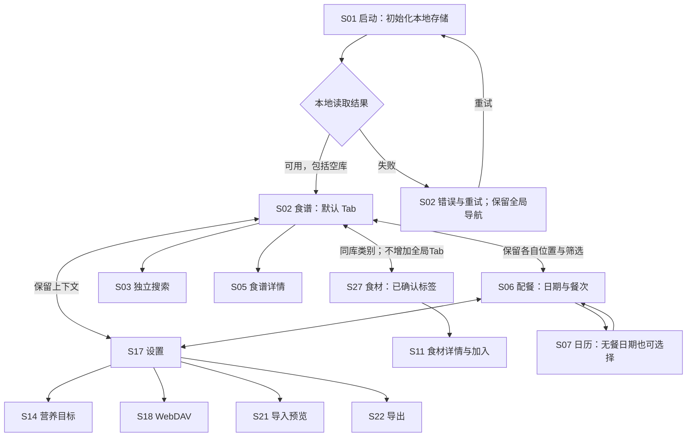
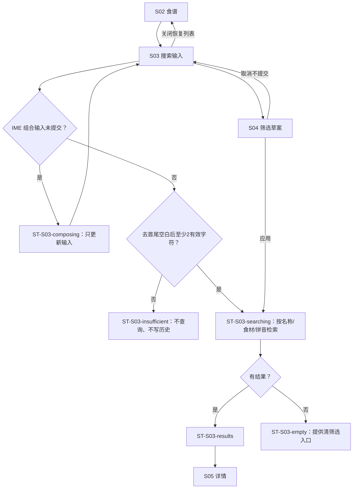
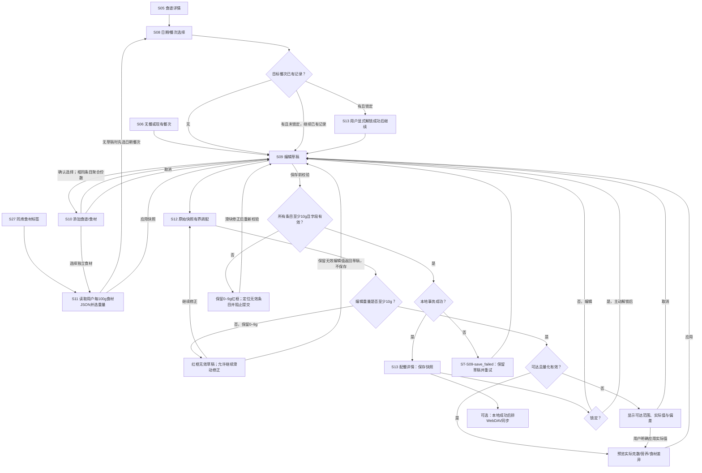
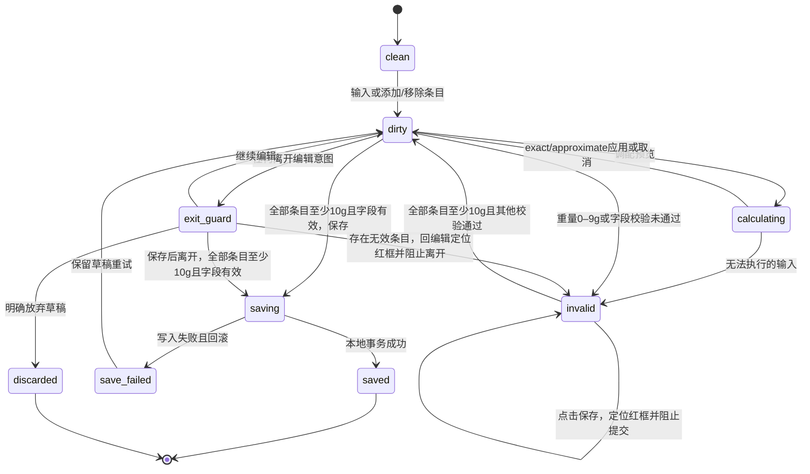
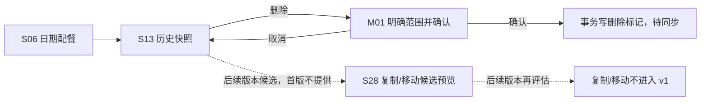
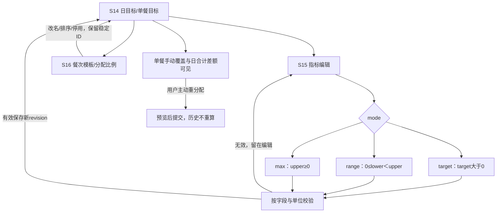
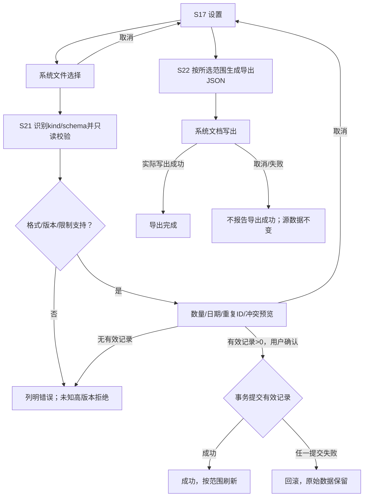
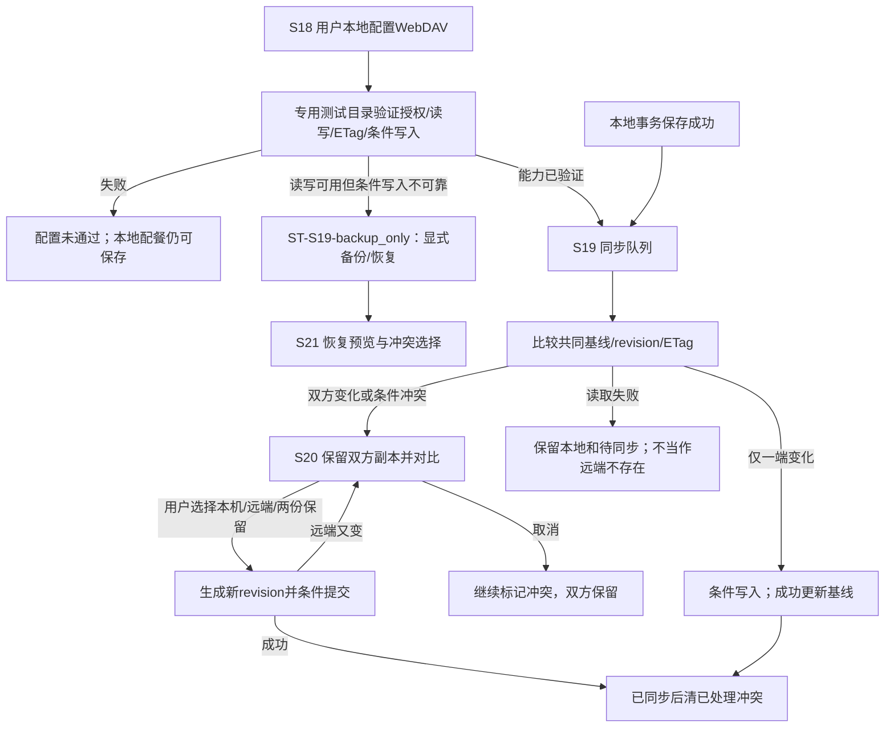
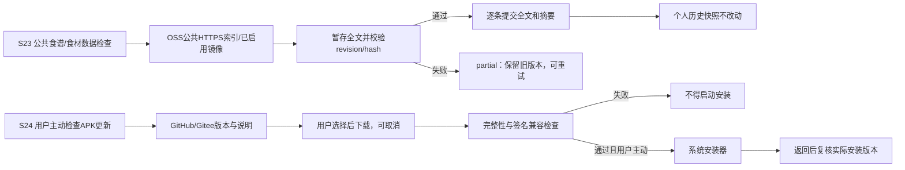

# 流程与状态图

> 可编辑 Mermaid 源稿。节点标签中的内部 ID 对应 [screen-contracts.json](screen-contracts.json)。图表达行为和数据边界，不规定最终新文案、字体或上游 API。所有图均需自检、总检、人工批次通过。

## F01 主导航与入口

启动不等联网。空库也进入默认食谱空态，错误可重试并保留导航。已有内容刷新失败保留本地可用版本，不能无限阻塞。食材是食谱库内标签，不是第四个全局 Tab。日历的今天、选中、有餐标识可以叠加。首次餐次模板默认为早餐、午餐、晚餐三餐；用户可在设置增删或改名，新名称按 D11 由用户确认。

## F02 搜索、IME 与筛选

同维度 OR，不同维度与搜索 AND。热量/重量/分类三组弹出菜单使用 Figma 已确认选项。搜索历史仅在用户提交有效查询时去重保存，应用不设条数上限，UI 最多显示 5 行，超出显示窗口的历史按设备策略清理。输入中间态不入历史。

## F03 核心配餐闭环

独立食材与食谱都保存当时口径和快照；缺营养为未知，不能视为 0。`locked` 食材克数保持；每次从原始快照计算，避免反复舍入漂移。热量未知时禁用热量求解，重量求解仍可标注不完整营养。不可达结果不称为精确达标。0–9g 保留为无效状态并显示红框，可通过滑块修正；点击保存时定位到无效条目并阻止提交，调整到至少 10g 后才满足重量有效条件，不能仅因存在另一条有效条目就绕过校验。移除是独立操作。

同日期+餐次只保存一份配餐，继续添加编辑已有。相同食谱/食材合并一条显示 `x2` 等份数，保留原始单份和 source count，展示聚合总重量和热量；微调 `+100g` 只给聚合总量加 100g。已确认 `300g×2=600g → 固定滑块500~700g → +100g=700g → 删除一份扣原始300g → 剩400g×1`，然后重算营养；不按平均350g扣减，也不将微调后的结果乘份数。滑块相对原始单份×当前份数仅±100g，不重复累加；份数变化后仍按剩余份数对应的原始叠加量计算固定范围，不以实际总量重锚。0–9g 属于可保留、可用滑块修正的红框无效状态，所有条目至少10g后才满足保存重量条件。删除导致负值例外强制归零，不能自动移除或改成10g；最后一份再删才移除。D04主体已确认；首版不提供直接输入，D12仅保留不同版本/计量状态identity、独立食材原始份量来源等契约设计，不能自行推定 Ingredient 每100g营养口径就是加入原始单份。

公共 Recipe 来源以 100g 起步；独立食材由用户单独编写每 100g 详细信息 JSON，与食谱共库发布。App 选取定义与重量后生成快照；无 App 内手工营养录入，不从食谱猜测食材营养。来源基准、Ingredient 每100g口径和配餐最低有效重量10g分别处理。具体 Ingredient schema 在 P0 设计，本轮不要求用户提前提供文件。

### 编辑状态与退出保护

状态对应 S09 的局部状态与 M02 退出弹窗；`exit_guard`、`discarded` 是图内控制节点，不是数据库状态。顶部返回、系统返回及跨 Tab 离开使用相同的草稿保护。仅本地保存成功后才完成“保存后离开”，同步失败不回滚本地成功。

## F04 历史、删除及候选转移

历史详情读取当时的食材、目标、营养和餐次名称快照，不随公共食谱和当前模板自动重算。更新为最新版必须另有明确预览操作。锁定记录仍可导出和同步。

虚线仅表示后续版本候选；首版不实施复制/移动，不占用首版承诺或阻塞查看、锁定和删除闭环。

## F05 目标类型与餐次分配

所有状态由当前实际值与字段契约判定，不把钠低于上限称为缺少；无目标或实际未知为中性。`max upper=0` 不做除零；达标阈值沿用接口契约，不另创“健康评分”。

## F06 导入、预览、回滚与导出

导入先预览，无效记录按原因列出；确认后只导入有效记录。例如10条中2条错误时导入8条，错误2条不写入；有效记录为0时禁止提交。导出排除凭据、密钥和日志；文件选择不要求默认全部存储权限。

## F07 123 WebDAV、冲突和降级

不按设备时钟决定胜负；删除使用 tombstone 防复活。`synced` 与“本地已保存”明确不同。123 云盘协议宣传不证明账号能力，本轮不索取授权、不操作账号。OSS 不是私人 WebDAV 同步后端。

## F08 公共食谱更新与 F09 APK 更新

公共源只读，不上传私人配餐，也不带 OSS 发布密钥。开发 0% 尚未部署返回 404 属正常状态；真实运行时源失败仍不能阻塞已有离线内容。APK 安装器返回不等于安装成功，取消更新不改配餐。

## F10/F11 通用显示、清理和诊断

S25 主题与减弱动画影响显示，不改变营养或保存结果。清图片缓存不能删除配餐。清全部本地数据分类处理：配餐按选项 2 同步删除远端副本；食谱仅清本地缓存并按云端重新同步，只有云端删除才同步移除食谱；两者均显示同步结果。S26 默认隐藏，版本号连续点击 10 次后才出现；诊断只读、脱敏。

所有流程都覆盖亮/暗、大字体、键盘、三键/手势导航、动画减弱。API 31/32 走清晰简化表面，API 33+ 增强材质需工程验证；业务状态和数据完全一致。任何新用户可见名称、提示文案先交用户确认，不从内部图标签直接生成最终字符串资源。
